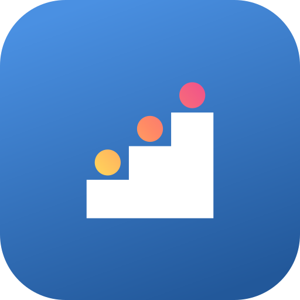
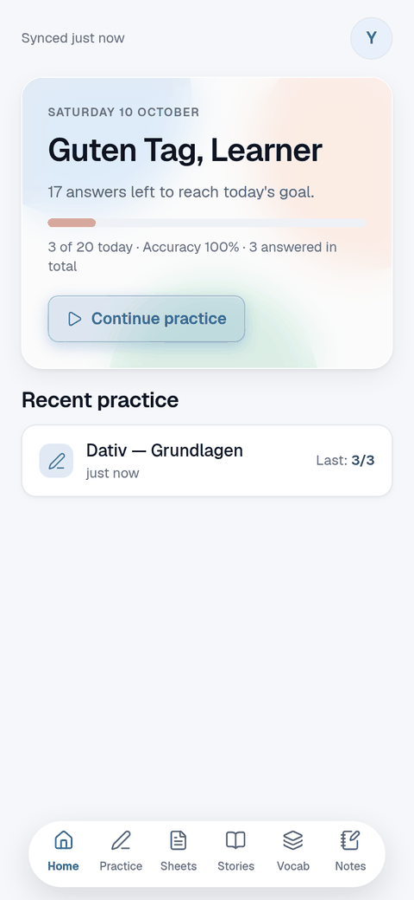
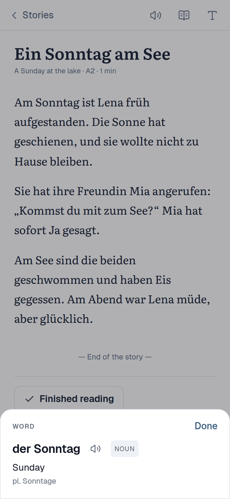
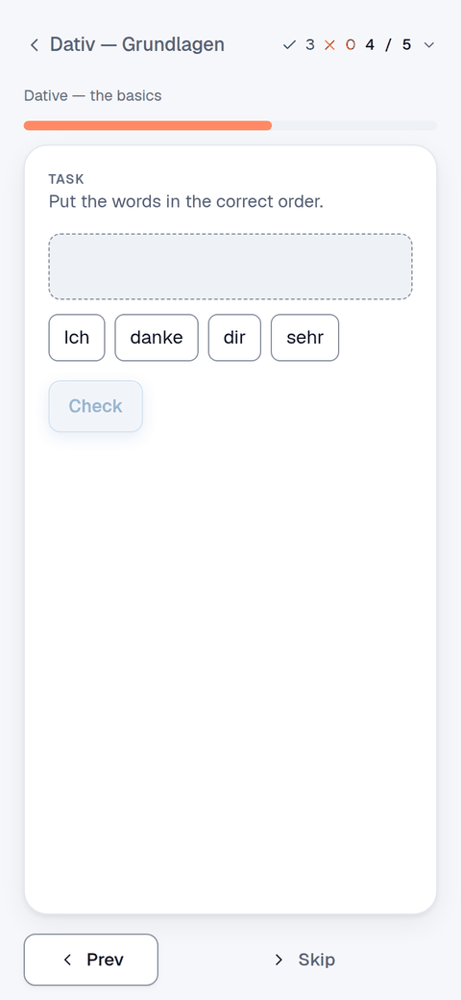
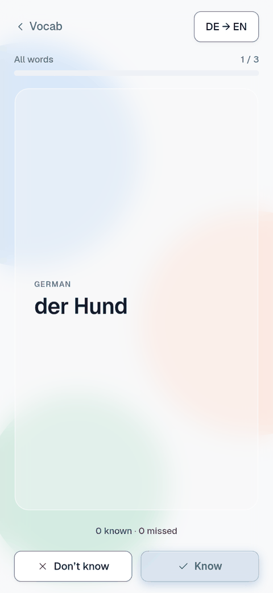

# Wortschritt



A self-hosted app for learning German, for you and a few people you share it
with. Read stories at your level, drill grammar, collect words and practise
them, keep notes, and get help from an AI tutor when you want it. It runs on
your own server, on the web and as an Android app that works offline.

<p>
  
  
  
  
</p>

## What you can do

### Read
- **Stories and books** in a reader made for reading: it turns pages like a
  book (or scrolls), with reading fonts, sizes, sepia and dark themes, and an
  e-ink mode for e-readers like a Boox. On Android the volume keys turn pages.
- **Tap any word** for an instant translation from a built-in offline
  dictionary, fuller definitions and examples from Wiktionary, an AI
  translation in context, and save it to your vocab in one tap.
- **English line by line** if you want it: hidden, blurred until you tap it,
  or always shown.
- **Read aloud**, following along page by page, with natural voices or your
  device's own.
- **Questions after each chapter** to check you understood (skip them if you
  like).
- **Generate a story** from a sentence with your AI tutor, at your level and
  around the words you're learning. Whole books, chapter by chapter, can be
  written by AI agents. Everything downloads as **EPUB** for e-readers.

### Practise
- **Exercise sets**: multiple choice, fill in the gap, build the sentence,
  transform, true or false, conjugation tables and flashcards. Wrong answers
  come back until you get them, and you can pick up where you left off.
- **Cheat sheets**: grammar at a glance, with tables, every word tappable and
  each section translatable.
- **Generate more** questions like the ones you just did.
- **Daily goal** and progress on the dashboard.

### Remember
- **Vocab** with translations, examples and grammar (article and plural,
  Partizip II, perfect tense auxiliary), organised in groups.
- **Flashcards** for any group: swipe right if you know it, left if not; your
  score is kept per word.
- **Notes** in Markdown, saved as you type; tidy them up with the AI or turn
  one into a cheat sheet.

### Get help
- **An AI tutor** (optional, bring your own OpenAI-compatible provider): a
  hint without the answer, "why was I wrong?", translations, follow-up
  questions, grading of free answers, and explanations of anything you
  highlight.

### Share and take with you
- **A few accounts on one server**: everyone has their own vocab, notes,
  stories and progress; exercise sets and cheat sheets are a shared library.
- **Android app** that works offline and syncs when it can (also in the
  background), with sounds, haptics and swipes, and a calm e-ink mode.
- **Add your own material** without coding: paste an exercise set or cheat
  sheet written by any LLM (the app gives you the prompt and checks the
  result), or let an AI agent add it through the built-in MCP server.

## Get it running

The server is one Docker image:

```bash
curl -O https://raw.githubusercontent.com/YamenSharaf/wortschritt/main/docker-compose.prod.yml
# create a .env with ADMIN_USERNAME, APP_PASSWORD, SESSION_SECRET and ENCRYPTION_KEY
docker compose -f docker-compose.prod.yml up -d
```

Then open `http://your-host:3000` and sign in. Updates, backups, voices and
all the settings: [docs/self-hosting.md](docs/self-hosting.md).

**Android app**: download the APK from
[wortschritt.yamen.dev](https://wortschritt.yamen.dev) and install it
(or use [Obtainium](https://github.com/ImranR98/Obtainium) with *Include
prereleases*). Enter your server's address and sign in. Details:
[docs/self-hosting.md#android-app](docs/self-hosting.md#android-app).

## Documentation

- [Self-hosting](docs/self-hosting.md): Docker, updates, backups, voices, the Android app.
- [Authoring content](docs/authoring-content.md): writing exercises, cheat sheets and stories (also with an LLM).
- [API and MCP server](docs/api.md): scripting the app and connecting AI agents.
- [Development](docs/development.md): the stack, running it locally, the data model.
- [Architecture](docs/architecture.md): how the web app, the Android app and the server fit together.
- [Design system](docs/design-system.md): colours, type and components.
- [AGENTS.md](AGENTS.md): orientation for AI agents working on the code.

## How it's made

Wortschritt is built by one person with a lot of help from an AI coding
assistant (Claude, through Claude Code): most of the code was written by
it under the maintainer's direction, and commits say so with a
`Co-Authored-By` trailer. Some of the built-in content and the stories are
AI-written too. In the app, the AI tutor, AI translations, generated
stories and "Generate more" questions come from an AI model you configure;
the app says so and they can be wrong.

## License

MIT, see [LICENSE](LICENSE). Bundled fonts, dictionary data and packages keep
their own licences: [THIRD_PARTY_NOTICES.md](THIRD_PARTY_NOTICES.md) (also in
the apps under Open-source licences; regenerate with `pnpm notices`).
